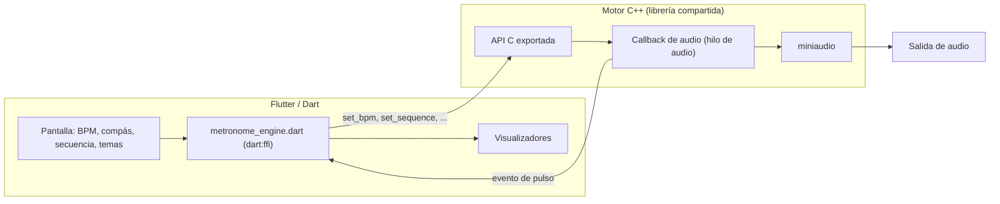

# Metronome App

Metrónomo para músicos con interfaz en **Flutter/Dart** y un motor de audio propio en **C++** (miniaudio), conectados mediante `dart:ffi`. Además de un compás fijo, permite armar **secuencias de compases con cambios de métrica** (por ejemplo 5/4 y luego 7/8) que se repiten en bucle.

 <!-- TODO: agregar captura -->

## Características

- **Tempo:** de 40 a 300 BPM, con botones de +/- y entrada numérica directa. El BPM se define sobre la negra.
- **Compás:** numerador de 1 a 16 y denominador 2, 4, 8 o 16. El denominador ajusta la duración de cada pulso.
- **Secuencia de compases:** se agregan bloques con "Add to score" y el motor los recorre en bucle, cambiando de métrica al terminar cada compás. Durante la reproducción, el bloque activo se resalta y la lista se desplaza sola.
- **Acento** en el primer pulso de cada compás, con un sonido distinto al del resto.
- **8 sets de sonido:** Default, Cowbell, Whistle, Block, Bit, Can, Clap y PracticePad.
- **4 temas de color:** Void Purple, Laser Red, Electric Blue y Amber.
- **7 visualizadores** del pulso (ver tabla abajo).

### Visualizadores

| Nombre | Qué muestra |
|---|---|
| Matrix | Una fila de cuadros, uno por pulso; se ilumina el pulso actual. |
| Pulse | Un círculo con el número del pulso que "rebota" en cada tiempo. |
| Border | Un recuadro cuyo borde brilla más en el primer pulso. |
| Rings | Un anillo dividido en arcos, uno por pulso. |
| Bars | Barras que crecen en el pulso activo (más altas en el acento). |
| Oscilloscope | Una línea tipo electrocardiograma que sube en cada pulso y decae. Es un efecto visual; no analiza la señal de audio. |
| Pong | Una pelota que viaja entre dos palas al ritmo del tempo, con la duración calculada según BPM y denominador. |

## Arquitectura



**Idea de diseño:** el tiempo lo lleva el motor, no la interfaz. El callback de audio cuenta muestras y decide cuándo empieza cada pulso, así que el ritmo no depende de los cuadros por segundo de Flutter ni de lo que esté haciendo la UI. Cuando comienza un pulso, el motor avisa a Dart con un callback (`NativeCallable.listener`) y la interfaz solo se actualiza para mostrarlo.


### API del motor (`metronome_engine.cpp`)

| Función | Descripción |
|---|---|
| `init_metronome()` | Inicializa el dispositivo de audio (estéreo, float de 32 bits, 48 kHz). |
| `play_metronome()` / `stop_metronome()` | Inicia y detiene la reproducción. |
| `set_bpm(bpm)` | Cambia el tempo. |
| `set_time_signature(num, den)` | Define el compás fijo. |
| `set_sequence(data, n)` | Define una secuencia de `n` compases como pares numerador/denominador. |
| `load_sample_from_memory(type, data, size)` | Decodifica un WAV en memoria; `type` 0 es el acento y 1 el pulso normal. |
| `set_beat_callback(cb)` | Registra la función que recibe cada pulso (pulso actual, pulsos por compás, si es acento). |

## Tecnologías

| Capa | Tecnología |
|---|---|
| Interfaz | Flutter / Dart (`CustomPaint` y animaciones para los visualizadores) |
| Enlace con el motor | `dart:ffi` y el paquete `ffi` |
| Motor de audio | C++ con [miniaudio](https://miniaud.io) 0.11.25 |
| Sonidos | Archivos WAV como assets de Flutter |

## Plataformas

El motor se carga como librería nativa en **Android, Linux y Windows** (`.so` y `.dll`). iOS y macOS no están soportados por ahora.

### Ejecutar la app

```bash
flutter pub get
flutter run -d linux     # o: windows, o un dispositivo Android
```

El archivo `main.cpp` es un prototipo en consola, anterior a la interfaz, que reproduce una secuencia fija de 5 y 7 pulsos a 120 BPM para probar el motor sin Flutter. No se compila junto con `metronome_engine.cpp`.

## Estado del proyecto

- La pantalla **Repertorio** (se llega deslizando) es por ahora solo una maqueta de la interfaz, sin funciones.
- Soporte para iOS y macOS: pendiente.

## Créditos

- [miniaudio](https://miniaud.io), de David Reid (dominio público o MIT-0).

## Autor

Emmanuel Alejandro Adame López · [GitHub](https://github.com/Emmanems567) 
